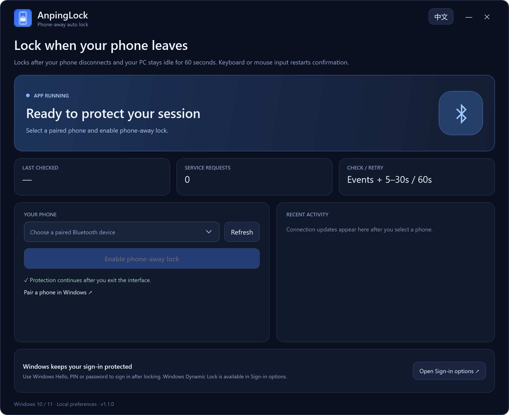
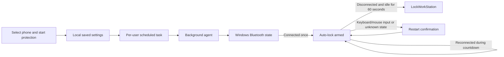
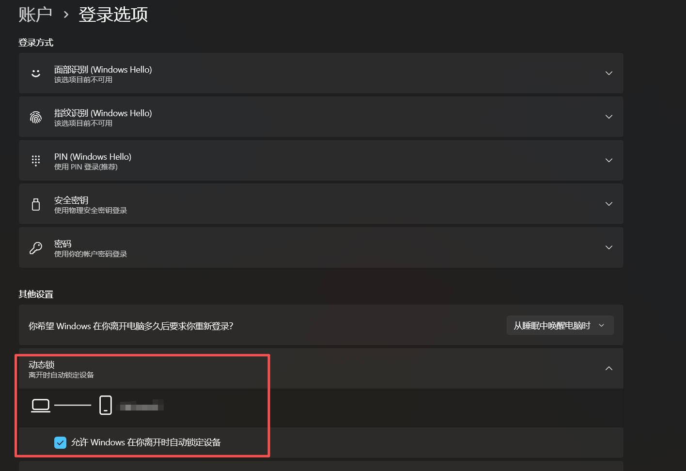

# AnpingLock · 离身锁

## Stepped away, then remembered you forgot to lock your PC?

AnpingLock helps with the lock-screen step that is easy to forget. Take your phone with you: confirmed Bluetooth disconnection and 60 seconds without keyboard or mouse input allow it to lock Windows. Closing the interface keeps the lightweight background agent running.

[](https://github.com/xkqin/anpinglock/releases/download/v1.1.0/AnpingLock-Setup-1.1.0-win-x64.exe)

**Download `AnpingLock-Setup-1.1.0-win-x64.exe`. The “Source code” ZIP/TAR files are for developers.**


<sub>Workplace photograph: [Mikhail Nilov / Pexels](https://www.pexels.com/photo/a-computer-on-an-office-desk-8297861/). Illustrative scene; [image credits](docs/assets/PHOTO_CREDITS.md).</sub>

[简体中文](README.md) · [Download for Windows](https://github.com/xkqin/anpinglock/releases/latest) · [Report an issue](https://github.com/xkqin/anpinglock/issues)

AnpingLock locks your Windows session after your selected phone has stayed disconnected from Bluetooth for 60 seconds and your PC has received no keyboard or mouse input for 60 seconds. Input restarts confirmation; unavailable Bluetooth or idle information pauses locking. Start protection once, then close the window or exit its tray menu. A separate background agent continues working.

## Actual v1.1.0 interface

Choose a paired phone, enable protection, and wait until it is connected and armed.



Click any image to view it at full size.

## Where to download and how to install

**[Download the installer directly](https://github.com/xkqin/anpinglock/releases/download/v1.1.0/AnpingLock-Setup-1.1.0-win-x64.exe)** · [Releases page](https://github.com/xkqin/anpinglock/releases/latest)

On the release page, expand **Assets** and choose the **.exe** file. It includes the required runtime; no source build is needed.

1. Download `AnpingLock-Setup-1.1.0-win-x64.exe` from Releases.
2. Run the installer. It installs for your Windows account and includes the .NET runtime.
3. Pair your phone in Windows Bluetooth settings.
4. Open AnpingLock, select the paired phone, and choose **Enable phone-away lock**.
5. Wait for **Phone connected. Auto-lock armed.** before testing it.

[Download v1.1.0](https://github.com/xkqin/anpinglock/releases/download/v1.1.0/AnpingLock-Setup-1.1.0-win-x64.exe)

Windows 10 version 2004 or later and Windows 11, x64. This release has an unsigned installer. Release assets include SHA-256 checksums.

## Low-resource background

Closing the interface leaves one native agent. On the development computer, v1.1.0 used approximately **18 MiB resident memory** and **3.5 MiB private memory**. A 30-second sample including Bluetooth connection changes consumed about 47 ms of CPU time and wrote about 1 KiB of heartbeat payload. Stable heartbeats run every 30 seconds; connection, session and settings events wake the agent when needed. These are measured examples, not hard limits, and an open WPF dashboard uses additional memory. [Validation and measurement conditions](docs/validation.md).

## What happens when I exit?

| Action | Result |
| --- | --- |
| Minimize | The interface moves to the tray. Protection continues. |
| Close the window | The interface exits. Protection continues. |
| Choose **Exit interface** in the tray | The interface and tray icon exit. Protection continues. |
| Choose **Stop protection** | The saved enable flag is cleared, the background task is stopped and removed. |
| Sign in or unlock Windows | Enabled protection is restored automatically. |
| Background agent ends unexpectedly | Windows Task Scheduler starts it again, normally within about a minute. |
| Uninstall | The background task and current application settings are removed. |

Open AnpingLock again to check the state, change the phone, or stop protection.

## How it works

AnpingLock has two processes. `AnpingLock.exe` is the on-demand .NET/WPF interface. `AnpingLock.Agent.exe` is a small native C++ process owning the Bluetooth device, absence timer, and Windows lock request. Closing the interface releases its runtime and leaves only the native agent, which does not load a CLR or forms runtime.



The agent responds to `ConnectionStatusChanged` events. Stable connections otherwise wake every 30 seconds; absence checks run every five seconds. When disconnected and unlocked, it requests uncached RFCOMM service discovery at most once per minute. Service discovery pauses while Windows is locked. It retains the device and discovered service objects between checks. The phone and Windows Bluetooth stack determine which connections and profiles remain active.

An observed connection arms protection. A subsequent confirmed disconnection starts a 60-second confirmation period. Reconnecting clears that timer. Keyboard or mouse input restarts confirmation, and the PC must remain idle for 60 seconds. A query timeout, error, unpaired device or unavailable idle reading clears the countdown instead of counting as absence. Fresh connection and idle observations are checked again immediately before the Windows `LockWorkStation` request. Windows Hello, PIN, or password provides sign-in afterward.

After a Windows unlock, AnpingLock waits for a fresh phone connection before arming again. Agent crash recovery can restore an armed countdown from a recent heartbeat belonging to the same Windows logon session. A monotonic clock tracks the active countdown.

The scheduled task runs in the current user's interactive session. It has sign-in and unlock triggers, failure recovery, and a one-minute repeating watchdog. A per-user mutex keeps one agent instance active. **Stop protection** saves the disabled state before removing that task, and the lock path checks the saved state again before requesting a lock.

See the source files in [the implementation guide](docs/architecture.md).

## Bluetooth and Windows Dynamic Lock

Bluetooth disconnection is the presence signal. Its range and timing depend on the phone, adapter, drivers, walls, and interference. A nearby phone can also disconnect because of its power-saving or Bluetooth profile policy; connection state is not a distance measurement. Recent keyboard or mouse input postpones locking. The confirmation period starts when Windows reports the disconnection. Polling and Bluetooth requests can add latency.

Windows Dynamic Lock is a separate Windows feature available in Sign-in options. AnpingLock makes its own lock request. With both enabled, Windows can also lock according to its own Dynamic Lock rules. The screenshots below show Windows' paired-phone status and Dynamic Lock settings.


<details>
<summary>Windows Dynamic Lock settings</summary>



</details>

Microsoft documents the APIs and Windows feature used here. [Bluetooth connection state](https://learn.microsoft.com/uwp/api/windows.devices.bluetooth.bluetoothdevice.connectionstatus) · [Uncached RFCOMM discovery](https://learn.microsoft.com/uwp/api/windows.devices.bluetooth.bluetoothdevice.getrfcommservicesasync) · [LockWorkStation](https://learn.microsoft.com/windows/win32/api/winuser/nf-winuser-lockworkstation) · [Windows Dynamic Lock](https://support.microsoft.com/windows/lock-your-windows-device-automatically-when-you-step-away-from-it-46b5c2b1-1b5d-2e02-1a2f-6fe1c612fd9d)

## Local data

Preferences are stored in `%LOCALAPPDATA%\AnpingLock\settings.json`. They contain the selected Bluetooth address and display name, enable flag, and interface language. Settings are cached, with a named event for changes and a one-minute fallback read. `agent-state.json` holds the heartbeat, connection state and idle seconds, updated every 30 seconds while stable and immediately on state changes. `agent-events.jsonl` records lock requests and errors with one rotated file after 1 MiB; normal Bluetooth fluctuations do not append logs. A startup error can produce `agent-error.log`. The interface keeps its recent activity list in memory.

Bluetooth queries, task registration, state files, and lock requests run locally.

## Build

On Windows, install the .NET 8 SDK, CMake, Visual Studio 2022 C++ Build Tools and a Windows SDK with C++/WinRT, then run this from the repository root.

```powershell
./scripts/build.ps1
```

The script runs managed policy checks and native/reference parity checks, builds the native x64 agent, publishes the self-contained interface, and builds the installer. It downloads a pinned, checksum-verified Inno Setup compiler package when needed. Outputs are written under `artifacts/`. Run `./scripts/measure-agent.ps1 -Seconds 60` to measure CPU, memory and IO for an installed agent.

```powershell
dotnet run --project tests/AnpingLock.PolicyTests -c Release
./scripts/build.ps1 -SkipInstaller
```

Developers can export a clean interface preview from a built executable.

```powershell
./artifacts/distribution/AnpingLock.exe --render-preview interface.png --english
```

## Validation

The policy checks cover initial arming, the 60-second threshold, reconnecting during a countdown, Windows lock/unlock, repeated requests, failed lock requests, and background recovery. Real-world walk-away behavior should be checked with the phone and adapter used on the target computer.

The release validation record is kept in [docs/validation.md](docs/validation.md).

## License and credits

Application source is released under the [MIT license](LICENSE). The application uses the Windows Bluetooth APIs, .NET 8, and Inno Setup. The bundled installer translation retains its upstream notices. [Third-party details](THIRD_PARTY_NOTICES.md)
