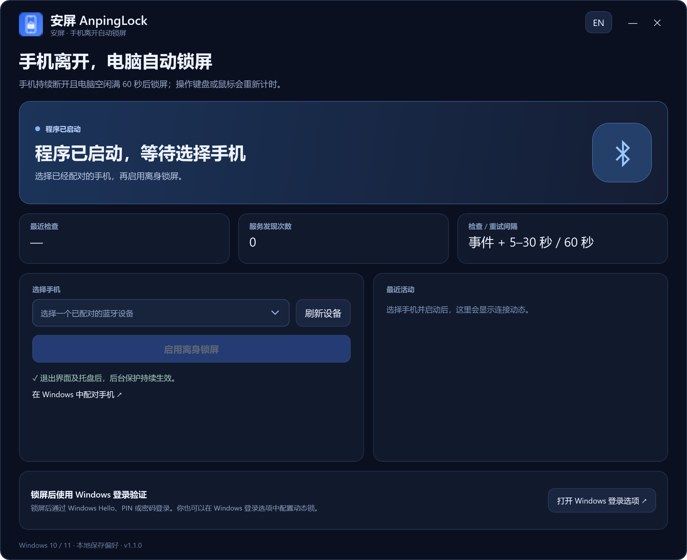
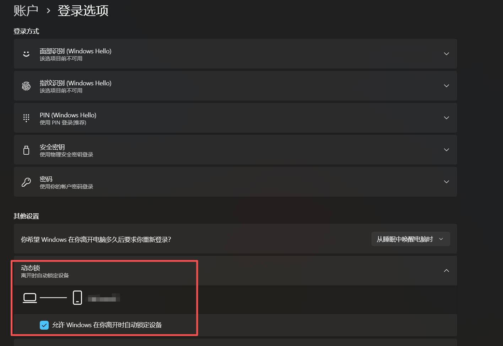

# 安屏 AnpingLock

## 离开工位，才想起电脑忘了锁屏？

**倒杯水、拿个快递、临时去开个会——人已经走了，电脑却还停在桌面。**

安屏，帮你省去忘记锁屏的烦恼。带上手机离开，蓝牙持续断开且电脑连续空闲满 60 秒后，程序会自动锁屏；你还在操作键鼠时，它会暂缓锁屏。

[](https://github.com/xkqin/anpinglock/releases/download/v1.1.0/AnpingLock-Setup-1.1.0-win-x64.exe)

**点上方蓝色按钮，下载 `AnpingLock-Setup-1.1.0-win-x64.exe`。不用下载源码，也不用自己编译。**

Windows 10 / 11 · x64 · v1.1.0 · 安装包约 69 MiB


<sub>实景摄影：[Mikhail Nilov / Pexels](https://www.pexels.com/photo/a-computer-on-an-office-desk-8297861/)。场景配图，非程序运行效果；[图片来源](docs/assets/PHOTO_CREDITS.md)。</sub>

[English](README.en.md) · [下载 Windows 安装包](https://github.com/xkqin/anpinglock/releases/latest) · [反馈问题](https://github.com/xkqin/anpinglock/issues)

启用一次，关闭窗口或退出托盘后，后台仍会继续保护。

## 程序实际长什么样？

选择已配对的手机，点击 **启用离身锁屏**。首次连接成功后，保护才会就绪。



*v1.1.0 实际程序界面，点击图片可查看大图。*

## 去哪里下载？怎么安装？

### [⬇ 点击这里直接下载安装包（Windows .exe）](https://github.com/xkqin/anpinglock/releases/download/v1.1.0/AnpingLock-Setup-1.1.0-win-x64.exe)

也可以进入 **[GitHub Releases 发布页](https://github.com/xkqin/anpinglock/releases/latest)**，展开页面下方的 **Assets（附件）**，选择 **AnpingLock-Setup-1.1.0-win-x64.exe**。

**不要误下 Source code (zip) 或 Source code (tar.gz)，它们是开发者用的源码。**

### 安装后这样使用

1. 下载 `AnpingLock-Setup-1.1.0-win-x64.exe`，双击安装。安装包自带所需运行环境。
2. 在 Windows 蓝牙设置中完成手机配对。
3. 打开 AnpingLock，选择这部手机，点击“启用离身锁屏”。
4. 等待界面显示“手机已连接，离身锁屏已就绪”。
5. 携带手机离开，待 Windows 报告蓝牙断开并完成 60 秒确认、且电脑连续空闲满 60 秒后，电脑会锁屏。

[下载 v1.1.0 安装包](https://github.com/xkqin/anpinglock/releases/download/v1.1.0/AnpingLock-Setup-1.1.0-win-x64.exe)

支持 Windows 10 2004 及以上版本、Windows 11，x64 架构。安装在当前用户目录，附带所需的 .NET 运行时。当前安装包未做代码签名，发布页同时提供 SHA-256 校验值。

## 低占用后台

退出界面后只保留一个原生后台进程。v1.1.0 本机实测常驻内存约 **18 MiB**、私有内存约 **3.5 MiB**；30 秒内包含手机连接变化的采样消耗约 47 毫秒 CPU 时间，写入约 1 KiB 心跳数据。稳定时每 30 秒更新心跳，连接、会话和设置事件按需唤醒后台。以上是特定测试条件下的实测值；打开 WPF 界面会增加临时占用。[验证记录与测量条件](docs/validation.md)。

## 退出以后还有效吗

| 操作 | 后台保护 |
| --- | --- |
| 最小化 | 界面收起到托盘，保护继续。 |
| 关闭窗口 | 界面退出，保护继续。 |
| 托盘选择“退出界面” | 界面和托盘图标退出，保护继续。 |
| 点击“停止保护” | 保存停用状态，并停止、移除后台任务。 |
| 登录或解锁 Windows | 自动恢复已经启用的保护。 |
| 守护进程意外结束 | 由 Windows 计划任务恢复，通常在约一分钟内。 |
| 卸载 | 清除后台任务和当前应用设置。 |

需要查看状态、换手机或停止保护时，重新打开 AnpingLock。

## 工作原理

程序分为两个进程。

- `AnpingLock.exe` 提供界面、手机选择和开始/停止控制。
- `AnpingLock.Agent.exe` 是原生 C++ 小进程，在后台持有蓝牙对象，检查连接状态，维护离开计时，并向 Windows 发出锁屏请求；常驻后台不加载 .NET 或窗体运行时。

界面退出时，守护进程继续运行。它通过当前用户的 Windows 计划任务启动，包含登录、解锁、失败恢复和每分钟一次的看门狗触发器。互斥锁限制同一用户同时运行一个守护进程。

### 蓝牙检测

通过 Windows 的 `ConnectionStatusChanged` 事件响应连接变化；稳定连接时每 30 秒检查，断开确认时每 5 秒检查。当手机处于断开状态时，最多每分钟请求一次未缓存的 RFCOMM 服务发现，并在两次检查之间保留设备和服务对象。锁屏期间暂停服务发现。手机和 Windows 蓝牙栈决定实际建立和维持的蓝牙连接。

### 离开确认

手机至少成功连接一次后，当前会话才进入保护状态。随后持续断开 60 秒、且电脑连续空闲满 60 秒，程序才会通过 `LockWorkStation` 锁定 Windows。键鼠操作会重新进行离开确认，手机重连会清零计时。查询超时、错误、取消配对或无法读取空闲时间均不作为确认离开的证据；恢复后重新确认。锁屏请求前再次检查连接和空闲时间。

手机就在旁边时，Windows 也可能因手机省电或蓝牙连接策略报告断开。“正在使用电脑，已暂缓锁屏”表示检测到了键鼠操作；蓝牙连接状态不等同于手机的实际距离。

Windows 解锁后，需要再次观察到手机连接才会重新就绪。守护进程意外重启时，可以从同一 Windows 登录会话的近期心跳中恢复保护状态和剩余计时。正常运行中的倒计时使用单调时钟。

### 停止与恢复

“开始”会保存启用状态、注册后台任务并立即启动守护进程。“停止保护”先保存停用状态，再停止并移除后台任务。发出锁屏请求前，守护进程还会复查当前保存的启用状态和选定设备。

更完整的代码入口和生命周期说明见[实现说明](docs/architecture.md)。

## 与 Windows 动态锁的关系

AnpingLock 自己根据蓝牙连接状态发出锁屏请求。Windows 登录选项中的“动态锁”也可以独立使用。两者同时启用时，Windows 还可能按自己的动态锁规则提前锁屏。

下面是本项目提供的 Windows 配对手机和动态锁设置截图，设备名称已脱敏。


<details>
<summary>展开查看 Windows 动态锁设置</summary>



</details>

蓝牙断开的距离和时间取决于手机、适配器、驱动、墙体和无线干扰。60 秒确认从 Windows 报告断开后开始计算，状态轮询和蓝牙请求也会带来额外延迟。实际使用时，请在自己的手机和电脑上测试一次离开、返回和解锁流程。

## 本地数据

设置保存于 `%LOCALAPPDATA%\AnpingLock\settings.json`，包括选定手机的蓝牙地址、显示名称、保护启用状态和界面语言。后台缓存设置，通过命名事件响应变更，并每分钟复查一次。`agent-state.json` 保存心跳、连接状态和空闲秒数，稳定时每 30 秒写入，状态改变时立即更新。`agent-events.jsonl` 仅追加锁屏请求及错误，不持续记录蓝牙波动，超过 1 MiB 时轮换一次。后台启动出错时，可能生成 `agent-error.log`。界面的最近活动列表保存在进程内存中。

蓝牙查询、任务注册、状态记录和锁屏调用均在本机进行。

## 从源码构建

在 Windows 上安装 .NET 8 SDK、CMake、Visual Studio 2022 C++ 生成工具及 Windows SDK（含 C++/WinRT），在仓库根目录执行下面的命令。

```powershell
./scripts/build.ps1
```

脚本会运行策略检查及原生/托管策略对照、构建原生 x64 后台、发布自包含界面，并生成安装包。需要时会下载固定版本、经过校验的 Inno Setup 编译器。输出位于 `artifacts/`。可运行 `./scripts/measure-agent.ps1 -Seconds 60` 测量已安装后台的 CPU、内存和写入量。

```powershell
dotnet run --project tests/AnpingLock.PolicyTests -c Release
./scripts/build.ps1 -SkipInstaller
```

## 验证与授权

策略检查覆盖首次连接、持续断开阈值、中途重连、锁定/解锁、重复锁屏请求、锁屏请求失败和后台恢复。实机验证记录见[验证说明](docs/validation.md)。

应用源码使用 [MIT 开源协议](LICENSE)。项目使用 Windows 蓝牙 API、.NET 8 和 Inno Setup，第三方说明见 [THIRD_PARTY_NOTICES.md](THIRD_PARTY_NOTICES.md)。
