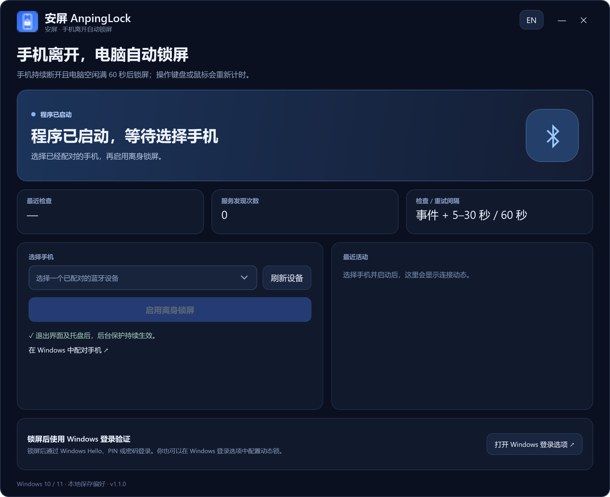

# 安屏 AnpingLock v1.1.0

## 离开工位，才想起电脑忘了锁屏？

**倒杯水、拿快递、临时去开个会——安屏，帮你省去忘记锁屏的烦恼。**

## [⬇ 直接下载安装包：AnpingLock-Setup-1.1.0-win-x64.exe](https://github.com/xkqin/anpinglock/releases/download/v1.1.0/AnpingLock-Setup-1.1.0-win-x64.exe)

Windows 10 / 11 · x64 · 安装后即可使用。也可在本页 **Assets（附件）** 中选择上面的 `.exe` 文件；普通使用不需要下载 Source code 源码压缩包。

实景摄影：[Mikhail Nilov / Pexels](https://www.pexels.com/photo/a-computer-on-an-office-desk-8297861/)，仅作场景示意。

## 这次统一换了什么？

- 项目和程序正式更名为 **安屏 AnpingLock**，包括窗口、托盘、安装包、进程、项目目录与 GitHub 仓库。
- 新安装包为 **AnpingLock-Setup-1.1.0-win-x64.exe**，新的后台为 **AnpingLock.Agent.exe**。
- 从旧版升级时，迁移已选手机、界面语言和保护启用状态，停用并移除旧后台任务，再启动新后台。
- 保留轻量原生后台、退出界面后继续保护，以及键鼠操作暂缓锁屏的规则。
- 设置保存在 `%LOCALAPPDATA%\AnpingLock`。已有新设置时，升级不会用旧设置覆盖。

## 实际程序界面

1. 在 Windows 蓝牙设置中配对手机。
2. 打开安屏，选择手机并启用保护，等待首次连接成功。
3. 带上手机离开。持续断开且电脑空闲满 60 秒后锁屏；键鼠操作会重新计时。

Windows 动态锁的设置保持不变，它可独立触发锁屏。安装包未签名。[图文说明](https://github.com/xkqin/anpinglock#readme) · [验证记录](https://github.com/xkqin/anpinglock/blob/main/docs/validation.md)。

English

The project is now **AnpingLock**. This release updates the application, installer, processes, source directories and repository name. Upgrading migrates the selected phone, language and protection intent, removes the old scheduled task and starts the renamed native agent. Existing AnpingLock settings take precedence. Low-resource background behavior and the keyboard/mouse idle guard are retained.

Download **AnpingLock-Setup-1.1.0-win-x64.exe** above or from Assets. Windows 10 2004+ / Windows 11 x64. Windows Dynamic Lock is unchanged. The installer is unsigned.

